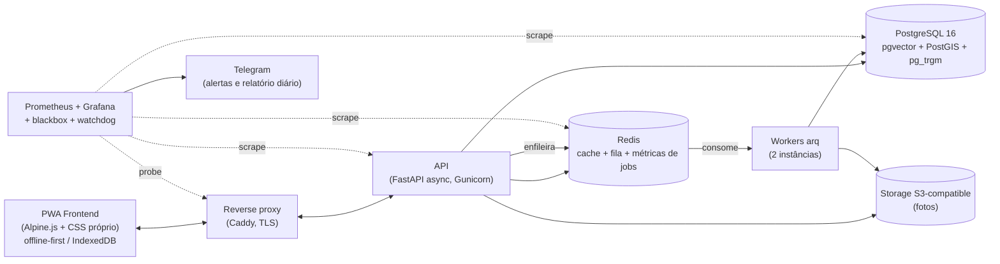
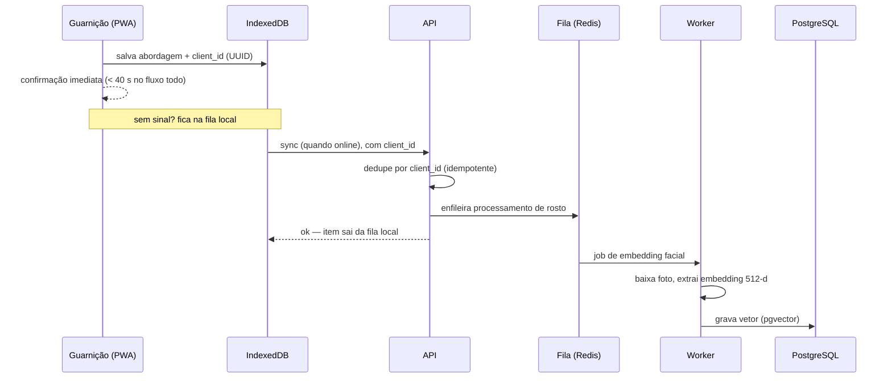

# Arquitetura

Visão geral dos componentes e das decisões estruturais do sistema.
Descrição conceitual — sem trechos de código de autenticação, permissões,
criptografia ou multi-tenancy (ver nota no [README](README.md)). Decisões
individuais estão registradas como [ADRs](docs/adr/).

## Componentes



| Componente | Responsabilidade |
|---|---|
| **PWA** | Interface de campo. Funciona offline (IndexedDB + Service Worker) e sincroniza quando a conexão volta. Sem build step: JS puro + Alpine.js, servido como arquivos estáticos. |
| **API** | Camada HTTP assíncrona: cadastro, consulta, busca, relatórios. Nunca executa trabalho pesado no caminho da requisição. |
| **Workers (arq)** | Tarefas caras e assíncronas por natureza: embedding facial, miniaturas, geração de PDF. Duas instâncias, monitoradas individualmente. |
| **PostgreSQL** | Fonte única de verdade, incluindo busca vetorial, geoespacial e fuzzy (ver abaixo). |
| **Redis** | Fila de jobs, cache de embeddings de busca e ponte de métricas do worker para a API. |
| **Storage S3** | Fotos e mídias, em volume dedicado. A API serve as imagens por um proxy próprio que valida a sessão antes de buscar no storage — o bucket nunca fica exposto. |
| **Observabilidade** | Prometheus + Grafana + blackbox (sonda externa) + watchdog independente. Alertas e relatório diário chegam no Telegram. |

## Camadas do backend

```
Router (HTTP)  →  Service (regra de negócio)  →  Repository (acesso a dados)  →  Model
```

- **Router** nunca contém lógica de negócio — só valida entrada e delega.
- **Service** nunca depende do framework HTTP — pode ser testado e
  reutilizado isoladamente (ex.: pelo worker de background).
- **Repository** concentra as queries; o restante do código não escreve SQL.
- Toda leitura de dado sensível passa por um filtro de contexto que
  restringe o escopo ao da guarnição do usuário — nenhuma query de
  aplicação lê fora desse escopo por padrão.
- **Async de ponta a ponta**: `asyncpg` + SQLAlchemy 2.0 async.

## Fluxo: cadastro de abordagem em campo



Pontos de projeto:

- **Idempotência por `client_id`**: reenvio por retry de rede ou
  reconexão nunca duplica registro — nem sob concorrência (ver
  [`client_id_dedup.py`](code-samples/backend/client_id_dedup.py)).
- **Progresso por foto**: se o envio cai no meio de uma abordagem com
  várias fotos, o retry retoma de onde parou
  ([`sync.js`](code-samples/frontend/sync.js)).
- **IA fora do caminho crítico**: o cadastro confirma na hora; o
  enriquecimento (rosto) acontece depois, no worker.

## Busca num único banco

Três perguntas diferentes, um único PostgreSQL:

| Pergunta | Técnica | Índice |
|---|---|---|
| "Quem se parece com este rosto?" | pgvector, distância cosseno (512 dim) | HNSW |
| "Quem foi abordado perto daqui?" | PostGIS `geography`, busca por raio | GiST |
| "Quem tem nome parecido, mesmo com erro de digitação?" | `pg_trgm`, similaridade por trigramas | — |
| "Ocorrências com sentido parecido" | pgvector (384 dim, SentenceTransformers) | HNSW |

Tudo é filtrável com SQL comum junto aos dados relacionais — sem sincronizar
dado entre um banco principal e um motor de busca separado. Ver
[ADR 002](docs/adr/002-pgvector-embeddings.md).

## Dados

Princípios que atravessam todo o modelo (ver [docs/data-model.md](docs/data-model.md)):

- **Nada é removido de verdade.** Toda entidade suporta exclusão lógica —
  o dado sai da visão do usuário, mas continua auditável.
- **Toda ação relevante é auditada**, com autor e timestamp.
- **Relacionamentos materializados**: o vínculo entre duas pessoas
  abordadas juntas vive em tabela própria, atualizado por UPSERT, em vez
  de ser recalculado a cada consulta.
- **Dois papéis de banco em produção**: a aplicação roda com um papel
  só-DML (sem poder de DDL); as migrations rodam com o papel dono. Um bug
  ou injeção na API não consegue alterar o schema.

## Pipeline de IA

- **Embeddings de texto** — SentenceTransformers
  (`paraphrase-multilingual-MiniLM-L12-v2`), com cache em Redis
  ([`embedding_service.py`](code-samples/backend/embedding_service.py)).
- **Reconhecimento facial** — InsightFace `buffalo_l` em CPU
  ([`face_service.py`](code-samples/backend/face_service.py)); rosto de
  maior confiança por foto, embedding de 512 dimensões.
- **Warm-up sem corrida** — com vários workers Gunicorn, o carregamento
  dos modelos é serializado por um lock inter-processo
  ([`interprocess_lock.py`](code-samples/backend/interprocess_lock.py)),
  para não disputar CPU no startup.
- **Regra de produto**: a IA organiza e conecta dados existentes; nunca
  gera fatos.

## Observabilidade

Alertas de produção são código, não configuração solta:

- As regras do Grafana são **convertidas para o formato do Prometheus e
  testadas no CI** (`promtool`), com cenários de comportamento — não só
  sintaxe ([`build_promtool_rules.py`](code-samples/monitoring/build_promtool_rules.py),
  [`promql_unit_tests.yml`](code-samples/monitoring/promql_unit_tests.yml)).
  Um smoke test sobe a stack real antes do merge.
- **Métricas de domínio da fila**: o worker não expõe HTTP, então escreve
  contadores no Redis e a API os publica como métricas Prometheus
  ([`job_metrics.py`](code-samples/backend/job_metrics.py),
  [`worker_health.py`](code-samples/backend/worker_health.py)). Dá para
  alertar "fila entupida" ou "todo job de rosto falhando", não só "processo
  de pé". Ver [ADR 004](docs/adr/004-ponte-metricas-worker-redis-api.md).
- **Watchdog independente**: um processo separado vigia o próprio sistema
  de alertas (dead-man's switch) — se o Grafana ou o Prometheus morrer, o
  silêncio não passa por "está tudo bem"
  ([`watchdog.py`](code-samples/monitoring/watchdog.py)).
- **Relatório diário** no Telegram com o resumo de saúde do sistema.

## Entrega e recuperação

- **CI**: lint (ruff, mypy), testes com Postgres+pgvector+PostGIS e Redis
  reais, e job de observabilidade. Segurança: Bandit, pip-audit,
  TruffleHog e revisão automática de PR.
- **Deploy**: containers Docker Compose em VM própria; o build das
  imagens acontece **antes** de parar a aplicação, então falha de build
  não derruba o serviço.
- **Backup em 3 camadas**: dump diário local; réplica cifrada (GPG) em
  dois provedores de nuvem independentes; script de restauração
  interativo. Plano de recuperação de desastre documentado e revisado.

Mais detalhes em [docs/engineering-practices.md](docs/engineering-practices.md).
