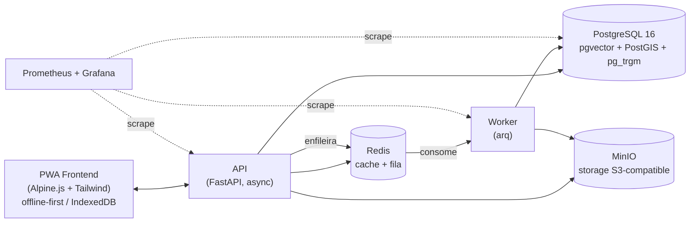

# Arquitetura

Visão geral dos componentes e decisões estruturais do sistema. Descrição
conceitual — sem trechos de código real (ver nota no README).

## Componentes



- **API**: camada HTTP síncrona para o usuário — cadastro, consulta, busca.
- **Worker**: tarefas pesadas e assíncronas por natureza (geração de
  embedding facial, OCR, geração de PDF) — nunca bloqueiam a resposta ao
  usuário em campo.
- **Banco**: um único Postgres com três extensões cobrindo três tipos de
  busca (vetorial semântica, geoespacial, fuzzy textual) — evita depender
  de um banco de busca externo separado para cada necessidade.
- **PWA offline-first**: a guarnição pode cadastrar uma abordagem sem
  sinal; os dados ficam em IndexedDB local e sincronizam quando a conexão
  volta.

## Camadas do backend

O backend segue uma separação estrita de responsabilidades:

```
Router (HTTP)  →  Service (regra de negócio)  →  Repository (acesso a dados)  →  Model
```

- Router nunca contém lógica de negócio — só valida entrada e delega.
- Service nunca depende do framework HTTP — pode ser testado e reutilizado
  isoladamente (ex: pelo worker de background).
- Toda leitura de dados sensível passa por um filtro de contexto que
  restringe o escopo à guarnição do usuário autenticado — nenhuma query
  de aplicação lê fora desse escopo por padrão.

## Dados

Dois princípios atravessam todo o modelo de dados:

- **Nada é removido de verdade.** Toda entidade suporta exclusão lógica —
  o dado sai da visão do usuário mas continua auditável, como exige o
  contexto de retenção de dados operacionais.
- **Toda ação relevante é auditada.** Criação, edição e exclusão lógica
  geram registro de auditoria com autor e timestamp.

## Observabilidade

Alertas de produção são código, não configuração solta: as regras do
Grafana são convertidas para o formato do Prometheus e testadas no CI
(`promtool`) a cada mudança, com um smoke test que sobe a stack real de
monitoramento antes do merge. Isso nasceu de incidentes reais em que um
alerta mal configurado ficou "preso" sem disparar — o objetivo é que esse
tipo de falha apareça no CI, não em produção.
