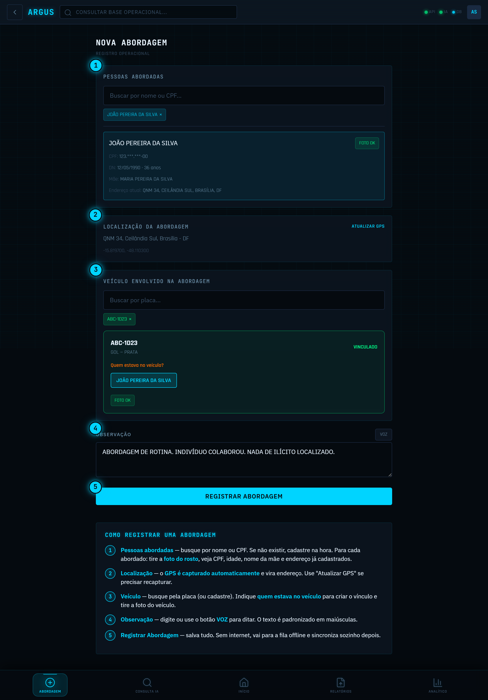
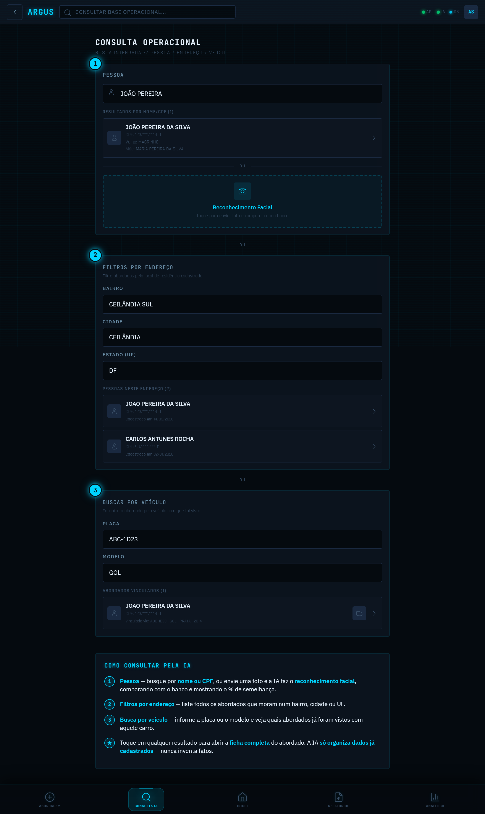

# Argus AI

Sistema de apoio operacional com IA para equipes de patrulhamento —
memória operacional da guarnição: abordagens, ocorrências, reconhecimento
facial, análise geoespacial e mapa de vínculos entre pessoas.

> **Este é um repositório de portfólio.** O sistema completo roda em
> produção num repositório privado. Aqui há documentação de arquitetura,
> decisões técnicas, lições de incidentes reais e uma seleção de código
> real do projeto — sem credenciais, dados operacionais, ou qualquer
> trecho de autenticação, permissões, criptografia ou multi-tenancy (a
> parte sensível do sistema fica de fora, por decisão deliberada).

## O problema

Guarnições em patrulhamento acumulam conhecimento operacional (quem já foi
abordado, com quem, onde, em que veículo) que hoje fica espalhado em
memória, boletins e sistemas que não conversam entre si. O Argus centraliza
essa memória operacional e usa IA para acelerar reconhecimento e busca —
sem nunca inventar fatos: a IA organiza e conecta dados que já existem,
não gera informação nova.

## Telas

Dados das capturas são fictícios (demonstração).

| Nova abordagem (< 40 s, offline-first) | Consulta operacional (nome, rosto, endereço, veículo) |
|---|---|
|  |  |

## O sistema em números

Medidos no repositório privado (novembro/2026):

| Métrica | Valor |
|---|---|
| Código de aplicação (`app/`) | ~23 mil linhas Python em 128 módulos |
| Testes automatizados | 154 arquivos, mais de 1.200 funções de teste (unitários, integração e e2e de navegador) |
| Endpoints HTTP | 87, versionados em `/api/v1` |
| Migrations de banco (Alembic) | 49 |
| Regras de alerta em produção | 23, todas testadas no CI |
| Histórico | ~1.660 commits desde fevereiro de 2026, um único mantenedor |

## Principais funcionalidades

- **Cadastro de abordagem em campo em menos de 40 segundos**, offline-first
  (funciona sem sinal e sincroniza depois, sem duplicar nada).
- **Reconhecimento facial** (InsightFace + pgvector) para identificação
  rápida a partir de uma foto.
- **Busca híbrida** num único banco: semântica (vetorial), geoespacial
  (raio, mapa de calor) e fuzzy (nomes com erro de digitação).
- **Mapa de relacionamentos** entre pessoas abordadas juntas, materializado
  com UPSERT e frequência/histórico de cada vínculo.
- **Ficha da pessoa em PDF** com marca d'água rastreável, gerada em
  background.
- **Conformidade LGPD**: criptografia em repouso, trilha de auditoria,
  exclusão lógica e retenção controlada.
- **Painel analítico e relatórios** com mapa de contadores por região.

## Onde olhar primeiro

| Se você quer ver… | Vá para |
|---|---|
| Como o sistema é montado | [ARCHITECTURE.md](ARCHITECTURE.md) |
| Os problemas de engenharia mais interessantes | [TECH-HIGHLIGHTS.md](TECH-HIGHLIGHTS.md) |
| Como o trabalho é conduzido (testes, CI, deploy, backup) | [docs/engineering-practices.md](docs/engineering-practices.md) |
| Incidentes reais e o que mudou depois deles | [docs/lessons-learned.md](docs/lessons-learned.md) |
| Decisões de arquitetura registradas (ADRs) | [docs/adr/](docs/adr/) |
| Modelo de dados | [docs/data-model.md](docs/data-model.md) |
| Código real de produção | [code-samples/](code-samples/) |

## Stack

| Camada | Tecnologias |
|---|---|
| Backend | Python 3.14 (3.11+ suportado) · FastAPI · SQLAlchemy 2.0 async · Alembic · Pydantic v2 · Gunicorn |
| Banco | PostgreSQL 16 com pgvector, PostGIS e pg_trgm |
| Filas e cache | Redis · `arq` (workers assíncronos) |
| IA | SentenceTransformers (busca semântica multilíngue, 384 dim) · InsightFace `buffalo_l` (rosto, 512 dim) |
| Frontend | PWA sem build step: HTML · Alpine.js · CSS próprio (design system escuro) · IndexedDB (Dexie) · Service Worker |
| Storage | S3-compatível (MinIO) |
| Observabilidade | Prometheus · Grafana · blackbox exporter · alertas no Telegram · watchdog independente |
| Qualidade | pytest (async) · Playwright (e2e) · Ruff · mypy · promtool |
| Segurança no CI | Bandit · pip-audit · TruffleHog · revisão de segurança automática em PR |
| Entrega | Docker Compose · GitHub Actions · deploy self-hosted (Oracle Cloud) · backup em 3 camadas |

## Em andamento

**Argus Trace** — chat em linguagem natural sobre a base inteira, com
abertura de um grafo de vínculos entre pessoas. Especificação fechada;
a construção segue em fatias verticais pequenas (cada uma com critério de
aceite e verificação próprios). A IA só orquestra consultas e organiza
resultados de dados já existentes — mantendo a regra "nunca inventa fatos".

## Sobre

Mantido por uma pessoa, do requisito ao deploy e à operação: modelagem de
dados, backend, frontend PWA, pipeline de IA, CI/CD, observabilidade,
backup e recuperação de desastre. O desenvolvimento usa um assistente de
IA (Claude Code) dentro de um processo definido — spec, testes primeiro,
verificação com evidência e revisão — descrito em
[docs/engineering-practices.md](docs/engineering-practices.md).

GitHub: [@alexmabud](https://github.com/alexmabud)
