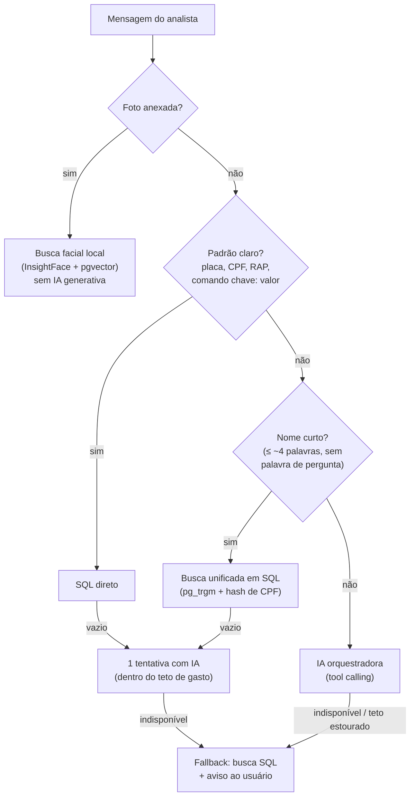
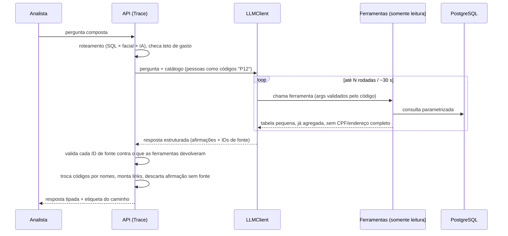

# Argus Trace — chat com IA e grafo de vínculos

Interface única de busca do Argus: o analista pergunta em linguagem
natural; o sistema consulta a base inteira e responde com **fontes
clicáveis**, abrindo um **grafo de vínculos** quando a pergunta é sobre
ligações entre pessoas.

> **Status (25/11/2026) — design fechado, implementação em curso.**
> Este documento descreve o sistema projetado (spec v3, 23 tarefas
> verticais). O código do Trace não está neste repositório: ele vive no
> repositório privado, em branches de feature, e a parte de IA ainda não
> foi construída. A tabela abaixo diz exatamente o que existe hoje.

| Grupo | Conteúdo | Tarefas | Situação |
|---|---|---|---|
| **A. Grafo (sem IA)** | Categoria "local da abordagem", vizinhança de uma pessoa, caminho mais curto, painel de evidências | 01–04 | 01 e 02 **implementadas e testadas** (18 testes só na vizinhança); **03 é a próxima a ser construída**; 04 a seguir |
| **B. Chat sem IA** | Roteamento por regras, busca por nome/placa/CPF/endereço/veículo/rosto, local da abordagem estruturado | 05–09, 22–23 | Especificado |
| **C. Texto livre** | Embeddings das observações, backfill, busca híbrida, medição | 10–14 | Especificado |
| **D. IA** | Cliente de LLM, ferramentas, laço do orquestrador, teto de gasto, medição, LGPD | 15–21 | Especificado; critérios de aceite e plano de medição definidos |

A ordem **A → B → C → D** é deliberada: tudo o que não precisa de IA é
construído antes, porque (1) é o *fallback* quando a IA está indisponível e
(2) cria as ferramentas que o orquestrador vai chamar.

## O problema

O Argus já materializa três fontes de vínculo entre pessoas e guarda muito
dado (pessoas, endereços, veículos, abordagens, fotos de evidência,
observações, ocorrências), mas não havia como **perguntar** ao sistema nem
**navegar** a rede de vínculos. A pergunta-guia que define o escopo é
composta, de propósito:

> *"Busque uma conexão entre João e José (pode ter ~6 pessoas no meio). Na
> mesma pergunta: teve droga envolvida no caminho? Essas pessoas são do
> mesmo bairro? Usaram o mesmo veículo?"*

Responder isso exige **compor** várias consultas (caminho no grafo +
agregação de evidências + comparação de bairro + veículos em comum). É o
motivo de existir um orquestrador, e não um simples roteador de intenções.

## Princípio de projeto: IA só quando necessária

A maioria das buscas **não precisa de LLM**. Antes de gastar, o código
decide o caminho, nesta ordem:

- **Cada resposta carrega a etiqueta do caminho** ("SQL · sem IA",
  "Reconhecimento facial · sem IA", "IA · N buscas internas"), e o código
  registra qual caminho cada mensagem seguiu. A **meta a medir** é a
  maioria das mensagens resolvida sem IA.
- **O chat não pode virar ponto único de falha** para a busca em campo:
  se a API do LLM cair, estourar o orçamento ou faltar rede, os caminhos
  de SQL e de rosto continuam funcionando e o chat diz o que ficou
  indisponível.
- **A foto de rosto nunca vai ao LLM.** Biometria é dado sensível; o chat
  aciona o endpoint de busca facial que já existe (modelo local), e o
  resultado vira apenas um `pessoa_id` de contexto para perguntas
  seguintes ("ache vínculo entre essa pessoa e o José").

## O orquestrador: tool calling com ferramentas só de leitura

O laço roda **no nosso servidor** (API de mensagens comum): a IA recebe a
pergunta e o catálogo de ferramentas; chama uma, o código executa e
devolve o resultado; ela decide a próxima, até ter o que precisa; então
escreve a resposta. Como um maestro: escolhe quem toca e quando, mas não
toca.

### Catálogo de ferramentas: poucas, gerais e combináveis

Usuários vão fazer perguntas que ninguém previu. Por isso o catálogo segue
o princípio **poucas ferramentas gerais e combináveis**, em vez de muitas
ferramentas estreitas, uma por pergunta:

1. **Resolver pessoa** (nome, apelido, nome da mãe, CPF por hash). Se
   houver mais de uma candidata, a IA **pergunta qual** antes de seguir.
2. **Buscar registros estruturados** com filtros combináveis por local,
   período, categoria de evidência, veículo e pessoa — uma **lista fechada
   validada pelo código**.
3. **Grafo**: vizinhança de uma pessoa e caminho entre duas.
4. **Agregadores sobre um conjunto de pessoas** (SQL no código, resultado
   compacto): evidências por categoria, bairros e veículos em comum,
   quantas vezes foram abordadas juntas.
5. **Busca por significado + palavra-chave** em textos livres.

As ferramentas devolvem **tabelas pequenas já agregadas**, nunca o banco
bruto. A IA **nunca executa SQL livre, nunca grava, nunca acessa a
internet**.

**Perguntas sem resposta viram sinal de produto:** o que o sistema não
guarda, a IA diz com clareza ("não guardo esse dado"), sem inventar — e a
frase (mascarada) é registrada com uma ação de auditoria dedicada. O dono
vê o que os usuários pedem e o catálogo ainda não cobre, e amplia as
ferramentas com base em demanda real.

## Garantias anti-alucinação (inegociáveis)

| Garantia | Como é imposta |
|---|---|
| Só dados do banco do Argus | Ferramentas são apenas buscas internas; sem internet |
| Nunca inventar | Sem resposta no banco → "não encontrei no sistema" |
| **Fonte sempre citada e checada pelo código** | A resposta final é estruturada: cada afirmação traz IDs de origem. O código confere que esses IDs apareceram nos resultados das ferramentas, monta os links e **descarta a afirmação sem fonte válida** |
| **A teia vem do código, não da IA** | O JSON do grafo é resultado de ferramenta; a IA só escolhe quais nós destacar (IDs validados). Não consegue inventar aresta |
| Sem interpretar imagem | Foto entra só por categoria, pessoa vinculada e texto |
| Só leitura | A IA não tem ferramenta de escrita; na fase 2 ela só *extrai campos* e quem valida e salva é o código |

Consequência de projeto: **sem streaming na fase 1**. Como o código valida
as fontes antes de mostrar, o texto só pode aparecer depois de pronto;
a tela mostra "buscando…" enquanto isso. Correção verificável tem
prioridade sobre sensação de velocidade.

## Grafo de vínculos

Três fontes de aresta, cada uma com sua origem na resposta:

| Fonte | Origem | Como nasce |
|---|---|---|
| Relacionamento materializado | `automatica_abordagem` | Coocorrência em abordagem; frequência por UPSERT |
| Vínculo manual | `manual` | Afirmado pelo operador (inclui comprador/vendedor com item) |
| Evidência compartilhada | `automatica_evidencia` | Foto de evidência com pessoa vinculada e categoria |

- **Duas modalidades**: exploração livre (vizinhança direta, expansão
  *lazy* por nó, sem teto de níveis) e **caminho mais curto** entre duas
  pessoas, com "mostra outro" para alternativas.
- **Algoritmo**: BFS em Python com **SQL só para vizinhos, em lote por
  nível** (`WHERE … IN`), em vez de uma consulta por nó.
- **Freios técnicos** (tempo ~10 s e limite de nós): quando disparam, a
  resposta é **`parcial`, nunca "sem conexão"**. Dizer que não existe
  caminho quando a busca apenas foi interrompida seria uma afirmação falsa —
  o tipo de erro que o projeto trata como pior que "não sei".
- **Hubs**: expansão mostra ~50 vizinhos por vez ("mostrando 50 de 300").
- **Honestidade visual**: vínculo manual tracejado, automático sólido;
  filtro liga/desliga cada fonte; nó com evidência grave destacado; se um
  filtro esconder o caminho, a tela avisa.

**Lição já aprendida na implementação (tarefa 02):** carregar a entidade
`Pessoa` inteira para montar um nó disparava **38 a 49 consultas** por
requisição (relacionamentos do modelo carregados automaticamente). A
solução foi ler só as colunas do nó — e **travar com um teste que conta as
consultas** (listener em `before_cursor_execute`), para a regressão
aparecer no CI e não em produção. O mesmo padrão vale para o caminho
mais curto e para as ferramentas da IA.

## Busca por significado em textos livres

- **Embeddings locais** (MiniLM multilíngue, 384 dimensões, gerados no
  worker) para observações e histórico de observações, com índice HNSW.
- **Busca híbrida**: palavra-chave (`pg_trgm`) **e** significado — a
  semântica não substitui a busca lexical, complementa.
- **Ocorrências em PDF** entram como fonte **secundária e rotulada**.
- **Medir antes de confiar**: o limiar de similaridade do código existente
  nunca foi medido sobre notas curtas reais. O plano é ~20 perguntas com
  resposta conhecida, rodadas localmente sobre uma cópia dos dados (sem
  envio externo), medindo acerto no topo antes de depender da busca
  semântica.

## Custo e resiliência

- **Provedor atrás de uma interface (`LLMClient`)**: trocar modelo ou
  provedor é configuração, e os testes usam um cliente simulado.
- **Modelo escolhido por medição**, não por preferência: começa pelo
  menor da família (Claude Haiku) e só sobe para o médio (Sonnet) se a
  avaliação reprovar na orquestração. Ordem de grandeza estimada: fração
  de centavo a poucos centavos de dólar por pergunta composta — a confirmar
  com a medição.
- **Teto de gasto em três camadas**:
  1. *por pergunta*: máximo de rodadas de ferramenta (8), de tokens e de
     tempo (~30 s; passou, devolve `parcial` com o que já achou);
  2. *por usuário/dia e global/mês* (contadores no Redis): estourou →
     o chat cai para buscas sem IA, com aviso;
  3. *limite mensal no console do provedor*, como rede de segurança externa.
- **Decisão de arquitetura**: laço de ferramentas no nosso servidor com a
  API de mensagens, **não** um serviço de agente gerenciado — esse guarda
  histórico de sessão do lado do provedor e não é elegível a retenção zero,
  o que seria incompatível com o requisito de privacidade.
- A chave de API vive só no ambiente de produção; **o CI nunca chama a API
  real**.

## Privacidade e LGPD

Dados do banco podem ir ao provedor do LLM em produção; por isso as
mitigações são obrigatórias e testadas:

- **Minimização**: nenhuma ferramenta devolve CPF, RG ou endereço completo.
- **Pseudonimização**: a IA recebe códigos ("P12") no lugar de nomes; o
  código troca pelos nomes na resposta final.
- **Máscara automática** de CPF e telefone em textos livres antes do envio.
- **Auditoria** de cada pergunta e de cada ferramenta acionada.
- **Conversa efêmera**: o contexto (para perguntas de continuação como "e
  esses dois usam o mesmo veículo?") vive só no Redis, com validade curta,
  e morre ao fechar o chat. Sem tabela de histórico no banco; só o log de
  auditoria (frase, caminho, ferramentas, IDs) persiste.
- **Dev, CI e avaliação da IA só com dado sintético.**
- O estado do chat e do canvas fica **só em memória do app** — nunca em
  `localStorage`/IndexedDB do navegador.

## Segurança do laço de IA

| Ameaça | Mitigação |
|---|---|
| **Prompt injection** via texto livre (uma observação ou PDF com "ignore as regras…" agora chega ao modelo) | Resultados de ferramenta entram como **dado**, não instrução; a IA só tem ferramentas de leitura; as citações são validadas pelo código; nada é gravado. Risco residual (resposta enganosa) é o motivo de a **fonte clicável ser obrigatória** |
| Laço que não termina / custo descontrolado | Teto em 3 camadas, máximo de rodadas, tempo total, fallback sem IA |
| Orquestração errada (ferramenta ou argumento) | Argumentos validados contra lista fechada; medição prévia com ~50 perguntas; subir de modelo se necessário |
| Vínculo fraco parecendo forte | Origem em cada aresta, tracejado × sólido, filtro por tipo |

## Como a qualidade será medida

1. **Unitários sem rede**: `LLMClient` simulado verifica que só as
   ferramentas permitidas existem, que a cadeia da pergunta-guia é
   executada na ordem, que ambiguidade gera pergunta, que citação inválida
   é descartada e que estouro de teto ou queda da API ativa o fallback.
2. **Integração**: seed com as três fontes de aresta na mesma pessoa.
3. **Avaliação com modelo real e dado sintético**: ~50 perguntas (simples,
   compostas, ambíguas e **sem resposta**) com a ferramenta/resultado
   esperado; mede-se acerto, custo e tempo por pergunta. **A medição decide
   Haiku × Sonnet.**
4. **Busca semântica**: ~20 perguntas com resposta conhecida em cópia local
   dos dados.
5. **Contrato de resposta tipado** (`texto`, `lista_registros`, `grafo`,
   `pergunta_acompanhamento`, `parcial`, `nao_encontrado`) — cada tipo é
   testável isoladamente.

## Como está sendo construído

- **23 tarefas verticais** (cada uma atravessa banco, serviço e endpoint e
  é demonstrável sozinha), em **4 branches de feature** na ordem A→D.
- Tarefas marcadas **AFK** (o assistente executa sozinho) ou **HITL**
  (exigem decisão humana: chave de API e limite de gasto, autorização
  institucional, migração em produção, medição).
- Cada tarefa: spec → teste primeiro → verificação com evidência →
  commit. Rotas nascem atrás de uma **chave de funcionalidade desligada**;
  só ligam depois da tarefa de LGPD e segurança.
- Fase 2 (futura): cadastro conversado — a IA só extrai campos, o código
  valida e grava após confirmação. Fase 3: demais cadastros, mesma regra.

As decisões de RAG (recuperação, embeddings, citação, avaliação) estão em
[rag-decisoes.md](rag-decisoes.md). Visão mais ampla de IA em [ai-engineering.md](ai-engineering.md);
decisões em [ADR 006](adr/006-orquestrador-llm-ferramentas-somente-leitura.md),
[ADR 007](adr/007-roteamento-ia-so-quando-necessaria.md) e
[ADR 008](adr/008-privacidade-pseudonimizacao-llm.md).
