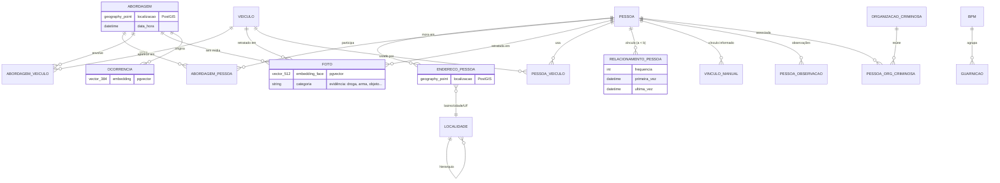

# Modelo de dados

Visão simplificada das entidades de domínio e de como se relacionam.
Colunas de identificação pessoal e de controle de acesso ficam de fora de
propósito (ver nota no [README](../README.md)); o foco é a *forma* do modelo.

## Convenções que valem para (quase) toda tabela

| Convenção | Como é aplicada |
|---|---|
| **Exclusão lógica** | Mixin `SoftDelete`: `ativo`, `desativado_em`, `desativado_por_id`. Nenhum dado é removido fisicamente. |
| **Carimbos de tempo** | Mixin `Timestamp`: `criado_em`, `atualizado_em` (UTC, preenchidos pelo banco). |
| **Auditoria** | Tabela `audit_logs`: quem, o quê, quando. |
| **Idempotência de sync** | Campo `client_id` (UUID gerado no cliente) com índice único parcial nas entidades criadas offline. |
| **Isolamento por guarnição** | Mixin dedicado nas entidades operacionais (detalhes fora deste repositório). |

## Decisões de modelagem

- **Abordagem ≠ Ocorrência.** A abordagem é o registro de campo (pessoas,
  veículos, local, fotos); a ocorrência é o registro de um fato, que pode
  nascer de uma abordagem. Misturar os dois travaria a evolução de ambos.
- **Vínculo entre pessoas materializado.** `relacionamento_pessoas`
  guarda o par com `pessoa_id_a < pessoa_id_b` (um par, uma linha) e uma
  restrição única; o vínculo é criado ou reforçado por UPSERT a cada
  abordagem conjunta, com frequência e primeira/última vez. Consultar "com
  quem fulano anda" vira um índice, não um self-join pesado. Código:
  [`relacionamento_repo.py`](../code-samples/backend/relacionamento_repo.py).
- **Vínculo manual separado do automático.** O que o sistema deduz
  (abordados juntos) e o que um operador informa (parentesco, associação)
  têm origem e confiabilidade diferentes, então vivem em tabelas distintas.
- **Localidade hierárquica.** Bairro → cidade → UF numa tabela
  auto-referenciada, o que permite filtros em cascata e contagens por região.
- **Vetores junto dos dados.** Embeddings ficam na mesma linha da foto ou da
  ocorrência (pgvector), então a busca por similaridade combina com filtros
  relacionais na mesma query.
