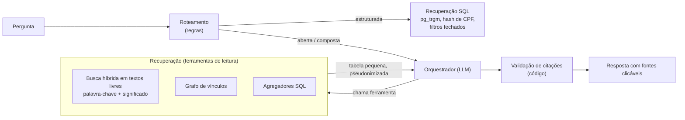

# RAG no Argus Trace — decisões de engenharia

O Argus Trace responde perguntas em linguagem natural **fundamentando a
resposta em dados recuperados do próprio banco**: é um sistema de
*retrieval-augmented generation* (RAG). Este documento registra as
decisões tomadas em cada etapa do pipeline, as alternativas descartadas e
o porquê.

> **Status:** design fechado (spec v3); implementação em curso. A busca
> por significado em textos livres está no grupo C das tarefas e o
> orquestrador no grupo D — ver [argus-trace.md](argus-trace.md). As
> decisões abaixo são as que governam essa construção.

## Visão geral do pipeline

A diferença para o RAG "clássico" (colar trechos recuperados no prompt) é
deliberada: aqui a **recuperação é feita por ferramentas que o modelo
chama**, e a **geração só pode afirmar o que cita**. É um RAG com
recuperação por *tool calling* (frequentemente chamado de *agentic RAG*).

## Decisões, uma a uma

### 1. O que recuperar: pessoas e registros, não trechos de texto
**Decisão.** A recuperação devolve **registros do domínio** (pessoas, com
link de ficha; abordagens; veículos), não parágrafos soltos.
**Por quê.** O usuário quer "quem", não "qual frase". Registro com ID é
citável e verificável; trecho solto não. A busca por significado em
observações devolve **pessoas** com a observação que casou como evidência.

### 2. Busca híbrida, não só vetorial
**Decisão.** Palavra-chave (`pg_trgm`) **e** significado (embeddings) na
mesma consulta, combinadas.
**Por quê.** Busca vetorial sozinha falha onde o analista mais precisa de
exatidão — apelidos, nomes próprios, siglas, placas — e acerta onde a
lexical falha ("quem ameaçou policial" vs "disse que ia matar o PM"). Uma
complementa a outra; nenhuma substitui.

### 3. Embeddings locais
**Decisão.** SentenceTransformers multilíngue (MiniLM, 384 dimensões),
gerados **no worker, no servidor próprio**.
**Por quê.**
- O texto das observações **nunca sai** do servidor para ser vetorizado:
  menos dado em trânsito para terceiros (ver
  [ADR 008](adr/008-privacidade-pseudonimizacao-llm.md)).
- Custo marginal zero por documento; roda em CPU, sem GPU.
- Já era o modelo em produção para ocorrências (consistência, uma só
  dimensão de coluna, uma só dependência).
**Troca aceita.** Um modelo local pequeno tem recuperação mais fraca que
um modelo de embedding de API de ponta — por isso o híbrido e a medição
(decisão 7).

### 4. Um banco só: pgvector com índice HNSW
**Decisão.** Vetores na mesma tabela e no mesmo PostgreSQL dos dados
relacionais, índice **HNSW** (distância cosseno).
**Por quê.** A recuperação combina similaridade com filtros relacionais
(local, período, categoria) **na mesma query**, sem sincronizar com um
banco vetorial externo. HNSW tem melhor *recall* que IVFFlat para tabelas
abaixo de ~1 milhão de linhas, que é o porte real. Ver
[ADR 002](adr/002-pgvector-embeddings.md).

### 5. Granularidade: um vetor por registro
**Decisão.** Observações são notas curtas → **um embedding por registro**
(observação da pessoa, histórico de observações, observação da
abordagem), sem *chunking*.
**Por quê.** Quebrar uma nota de poucas linhas em pedaços só fragmentaria
o sentido e multiplicaria linhas. Para as **ocorrências em PDF** (longas),
o embedding cobre o início do documento — limitação conhecida e
declarada, e por isso essa é uma **fonte secundária e rotulada** como tal
na resposta.

### 6. Frescor: o índice acompanha o dado
**Decisão.** Embedding **atualizado a cada criação/edição** (no worker, fora
do caminho da requisição) e **backfill** dos registros existentes.
**Por quê.** Índice defasado em relação ao dado gera respostas que
omitem registros recentes — pior num sistema operacional, onde o dado
mais novo costuma ser o mais relevante.

### 7. Medir antes de confiar
**Decisão.** A busca por significado só entra no caminho do usuário
**depois** de medida: ~20 perguntas com resposta conhecida, em cópia
local dos dados, medindo acerto no topo. O limiar de similaridade
herdado do código anterior **nunca foi medido** e não é tratado como
verdade.
**Por quê.** MiniLM sobre notas curtas e BOs é uma combinação sem
resultado publicado; chutar o limiar produz tanto falso negativo
(omissão) quanto falso positivo (vínculo inventado).

### 8. A geração só afirma o que cita — e o código confere
**Decisão.** A resposta final é **estruturada**: cada afirmação traz IDs
de origem; o código **confere os IDs contra o que a recuperação
devolveu**, monta os links e **descarta** a afirmação sem fonte. Sem dado
no banco → "não encontrei no sistema".
**Por quê.** É a defesa contra o modo de falha central do RAG — o modelo
misturar o que foi recuperado com o que "sabe" — transformada de
promessa em verificação executável. **Consequência:** sem *streaming* na
fase 1 (a validação precisa da resposta completa).

### 9. Recuperar pouco, já agregado
**Decisão.** Ferramentas devolvem **tabelas pequenas e agregadas**, nunca o
banco bruto nem blocos grandes de texto.
**Por quê.** Contexto menor = menos custo, menos latência, menos
superfície para injeção de prompt e menos chance de o modelo se perder.
A agregação (contagens, bairros em comum, veículos em comum) é **SQL no
código**, não aritmética do modelo.

### 10. Poucas ferramentas gerais, filtros em lista fechada
**Decisão.** Um catálogo pequeno e combinável, com filtros validados contra
uma lista fechada, em vez de uma ferramenta por pergunta ou *text-to-SQL*.
**Por quê.** Cobre perguntas imprevistas sem dar SQL livre ao modelo. O
que o catálogo não cobre vira **resposta honesta + registro da lacuna**
(ação de auditoria dedicada), alimentando o backlog com demanda real.

### 11. Conteúdo recuperado é dado, nunca instrução
**Decisão.** Texto recuperado (observação, PDF) entra no contexto como
**dado**; o modelo só tem ferramentas de **leitura**; citação é validada;
nada é gravado.
**Por quê.** Observações e PDFs são texto livre escrito por terceiros: o
vetor clássico de *prompt injection indireto* num RAG. O risco residual
(resposta enganosa) é exatamente o motivo da **fonte clicável
obrigatória**.

### 12. Privacidade na fronteira do LLM
**Decisão.** Recuperação **local**; para o LLM vão códigos no lugar de
nomes ("P12"), sem CPF/RG/endereço completo, com CPF e telefone mascarados
em texto livre; foto e biometria nunca vão. Ver
[ADR 008](adr/008-privacidade-pseudonimizacao-llm.md).

### 13. Fallback sem LLM
**Decisão.** Roteamento em cascata (foto → SQL → LLM) e queda para busca
sem IA quando a API falha ou o orçamento acaba. Ver
[ADR 007](adr/007-roteamento-ia-so-quando-necessaria.md).
**Por quê.** Recuperação é a parte *determinística* e barata do RAG;
a geração é a parte cara e opcional. Separar as duas mantém a busca
funcionando quando o LLM não está.

## Como a qualidade do RAG será avaliada

Recuperação e geração são avaliadas **separadamente** — misturá-las
esconde onde está o erro:

| O que se mede | Como |
|---|---|
| **Recuperação** (a busca achou os registros certos?) | ~20 perguntas com resposta conhecida em cópia local; acerto no topo-*k*, com e sem a parte semântica, para provar que o híbrido paga seu custo |
| **Escolha de ferramentas** (o modelo recuperou da forma certa?) | ~50 perguntas sintéticas com ferramenta e resultado esperados, incluindo compostas e ambíguas |
| **Fidelidade** (a resposta só diz o que foi recuperado?) | Teste determinístico da validação de citação: ID forjado é descartado |
| **Recusa correta** (sabe dizer "não sei"?) | Perguntas **sem resposta** no conjunto de avaliação |
| **Custo e tempo** | Medidos por pergunta; decidem entre modelo menor e médio |

## Alternativas descartadas

| Alternativa | Motivo |
|---|---|
| Banco vetorial dedicado (serviço externo) | Mais uma peça para operar e sincronizar; perde o filtro relacional na mesma query |
| Embeddings de API de terceiros | Mandaria todo texto de observação para fora só para indexar |
| *Text-to-SQL* | SQL livre para o modelo: superfície de ataque e resposta não citável |
| Colar trechos no prompt (RAG clássico) | Contexto grande e barulhento; sem como verificar de onde veio cada afirmação |
| Serviço de agente gerenciado pelo provedor | Guarda histórico de sessão fora do nosso controle; incompatível com o requisito de retenção |
| Só busca vetorial | Falha em nomes, apelidos e códigos exatos |
